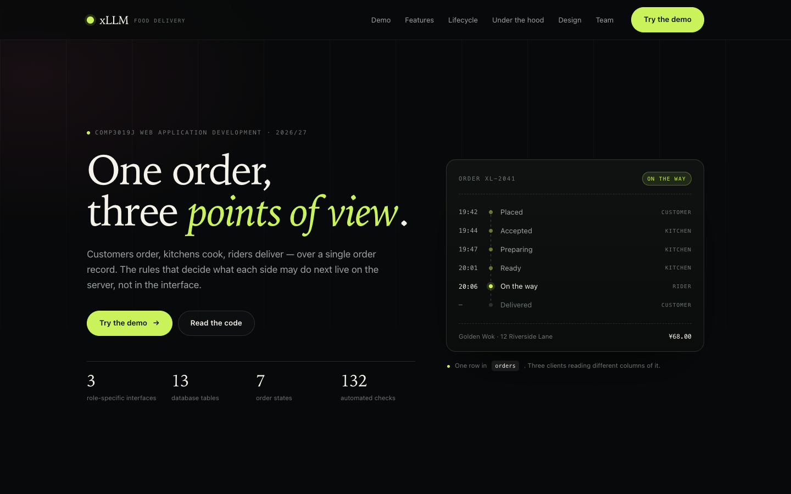
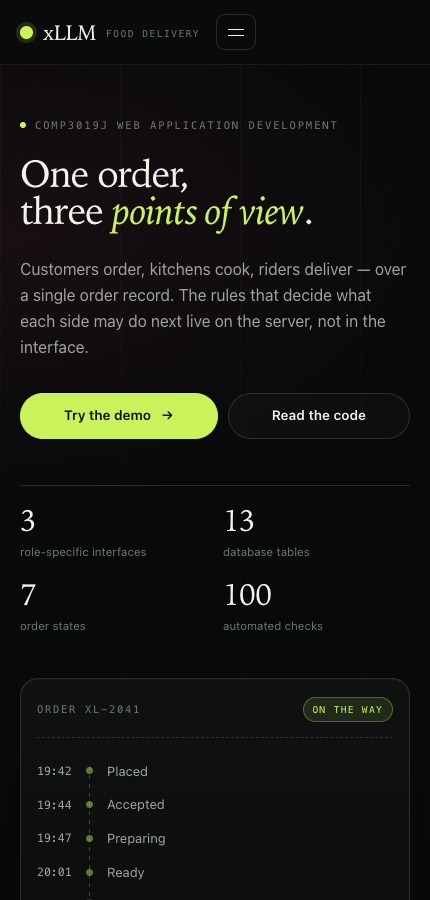
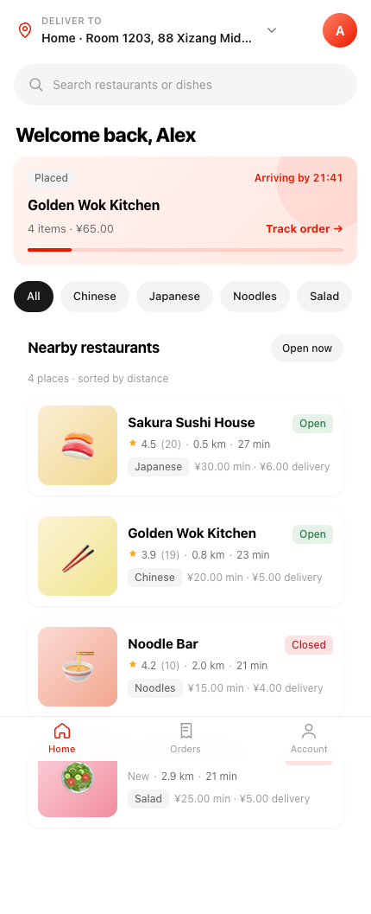
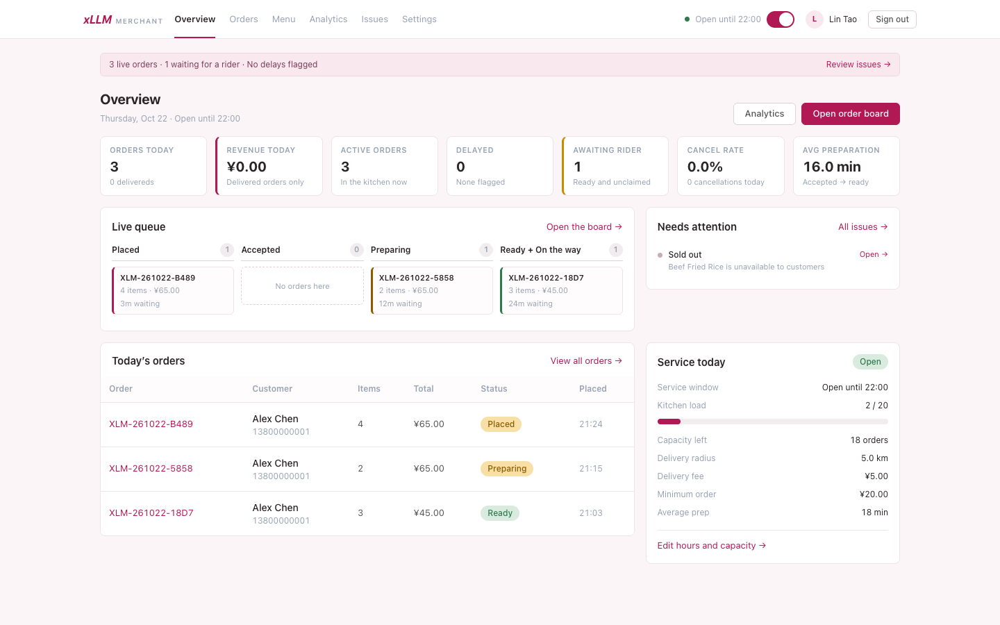
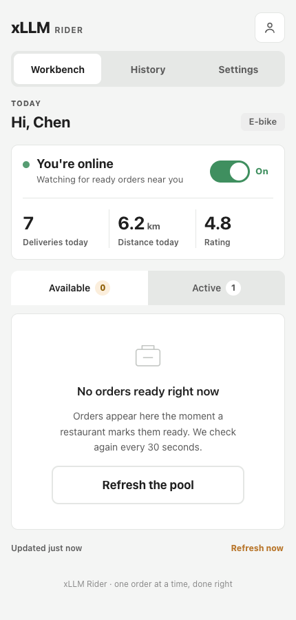

# xLLM — Food Delivery Website

**COMP3019J Web Application Development 2026/27 · Final Project · Topic 7**

Team **xLLM**: Fu Rao · Liu Jing · Liu Zongrun · Zhou Jiaxu

Live deployment — each interface has its own domain, so the three can be signed in at once:

| Interface | Address | Demo account |
|---|---|---|
| Customer app | **https://customer.xllm.cloud** | `alex` |
| Restaurant console | **https://restaurant.xllm.cloud** | `goldenwok` |
| Rider app | **https://delivery.xllm.cloud** | `chen` |
| Project site & operations wall | **https://xllm.cloud** → `/info/` | — |

All demo accounts use the password `demo1234`. The project site links into all four surfaces.

---

## What this is

A local food-delivery platform connecting three parties — **customers**, **restaurants** and
**delivery riders** — over one shared order. The project is built around two things the topic
states explicitly: a **shared order state machine** that three roles advance in turn, and
**role-based information isolation** enforced on the server (`without giving everyone access to
the same information`).

Scope, requirements (`FR-1` … `FR-26`) and design rationale are in
[`docs/M1-设计报告.md`](docs/M1-设计报告.md).

## What is implemented

| Role | Pages |
|---|---|
| **Customer** (phone UI) | sign in / register / verification-code sign in / reset password · restaurant list with cuisine filter · search restaurants + dishes · restaurant menu with cart · cart · checkout with address + delivery-radius check + mock payment · order history · live order progress, cancel, rate · address book · profile |
| **Merchant** (desktop UI) | sign in / register · store onboarding · overview KPIs · four-column order board · order detail with accept / decline / start preparing / mark ready / flag delay · menu CRUD with stock, sold-out switch and one-click restock · opening hours + capacity settings · analytics (7/14/30 days) · issues and after-sales |
| **Rider** (phone UI) | sign in / register · workbench with online toggle, claimable pool and active deliveries · atomic `Grab order` (two riders cannot win the same order) · order detail with pickup / delivered actions and Gaode navigation links · automatic + manual location reporting · delivery history · settings |

Shared server-side behaviour: one order state machine, ownership checks on every query,
opening-hours/capacity gating, delivery-radius validation (Haversine), stock checks, delay flags,
duplicate-review protection, GPS sanity checks, and email verification codes.

## Stack

| Layer | Technology |
|---|---|
| Backend | Python 3.10+ · Flask 3.1 · SQLAlchemy 2.0 |
| Database | MySQL 8 (13 tables) · SQLite for local development |
| Templates | Jinja2 |
| Front end | HTML5 · CSS3 · vanilla JS (`fetch`) |
| Deployment | nginx (TLS) + gunicorn + systemd |
| Map | Amap (Gaode) JS API + Web service API — declared under brief §4 |

## Repository layout

```
server/            Flask application
├── app.py         application factory (single entry point)
├── shared/        models · order_flow · security · auth · mailer · health · seed
├── customer/      customer pages + /api/customer endpoints
├── merchant/      merchant pages + /api/merchant endpoints
├── rider/         rider pages   + /api/rider endpoints
└── info/          the public project site    (/info) — no database, no session
database/          schema.sql · ER diagrams
docs/              reports, API contract, design docs, deployment guide
deploy/            systemd unit · nginx site configs
tools/             migrate.py · smoke_test.py · gen-art.mjs · install-tls.sh
```

Photography is generated, not borrowed: 4 restaurant covers, one photo per dish (32) and a
rider sign-in shot, produced with Volcengine Ark Seedream from the prompts in
[`docs/art-spec.json`](docs/art-spec.json). How to regenerate or add one:
[`docs/插图与配图.md`](docs/插图与配图.md).

**The directory tree *is* the division of work** — one folder per role, so each member can open
their own slice during the demonstration. Details: [`docs/代码结构.md`](docs/代码结构.md).

Two things are deliberately *not* per-role: `shared/models.py` and
`shared/order_flow.py` (the order state machine). Duplicating those would give one order three
implementations.

## Design

The three interfaces are **three independent design systems**, not three skins over one layout —
customers browse on a phone, restaurants work a dense desktop queue, riders operate one-handed
outdoors. What they share is not pixels but terminology, data and API contract.
See [`docs/设计语言.md`](docs/设计语言.md) and the live specimens:

- https://customer.xllm.cloud/customer/design-system
- https://restaurant.xllm.cloud/merchant/design-system
- https://delivery.xllm.cloud/rider/design-system

There is also a fourth, equally separate surface: the **operations wall** at `/admin/` —
a dark, read-only console for platform staff (no marketplace account, no `users` row, no write
endpoint). It shares only `reset.css` and the status vocabulary with the three apps.
Details: [`docs/管理大屏.md`](docs/管理大屏.md).

## Screenshots

The project site — what `https://xllm.cloud/` now opens:

| Desktop | Phone |
|---|---|
|  |  |

The three interfaces, captured from the running application (see
[`docs/screenshots/`](docs/screenshots/)):

| Customer | Merchant | Rider |
|---|---|---|
|  |  |  |

## Running locally

### Option A — SQLite, no database server needed (fastest)

```bash
cd server
python3 -m venv ../.venv && ../.venv/bin/pip install -r requirements.txt

export DATABASE_URL="sqlite:///$(pwd)/dev.db"
../.venv/bin/python -m shared.seed --reset     # demo data
../.venv/bin/python app.py                     # http://127.0.0.1:8080
```

### Option B — MySQL (same as production)

```bash
cd server
python3 -m venv ../.venv && ../.venv/bin/pip install -r requirements.txt
cp .env.example .env                 # then fill in DB_PASSWORD / SECRET_KEY / MAIL_*
set -a; . ./.env; set +a
../.venv/bin/python ../tools/migrate.py
../.venv/bin/python -m shared.seed
../.venv/bin/python app.py
```

### Demo accounts (password `demo1234`)

| Role | Account | Extra accounts |
|---|---|---|
| Customer | `alex` | `mia` |
| Merchant | `goldenwok` | `noodlebar`, `sakura`, `greenbowl` (paused) |
| Rider | `chen` | `zhao`, `liu` |
| Operations console | `admin` | set `ADMIN_PASSWORD` in `.env` to replace the demo passphrase |

| URL | Purpose |
|---|---|
| `/` | **redirects to `/info/`** (the public site) |
| `/info/` | public project site: what it is, demo entry points, lifecycle, design notes |
| `/customer/` · `/merchant/` · `/rider/` | the three interfaces |
| `/admin/` | operations wall — KPI, live orders, kitchen load, rider fleet, alerts (read-only) |
| `/customer/design-system` · `/merchant/design-system` · `/rider/design-system` | design specimens |
| `/api/ping` · `/api/db-ping` | liveness · database connectivity |

## Testing

`tools/smoke_test.py` rebuilds a throw-away database, seeds it, then plays customer → merchant →
rider through the whole order lifecycle plus the failure paths (minimum order, sold-out dish,
out-of-radius address, late cancellation, double review, atomic claim, GPS sanity, IDOR on all
three roles, page rendering, the public site, the operations console and the
subdomain routing — 132 checks):

```bash
cd server
DATABASE_URL="sqlite:////tmp/xllm-smoke.db" ../.venv/bin/python ../tools/smoke_test.py
```

## Documentation

| Document | Contents |
|---|---|
| [`docs/M1-设计报告.md`](docs/M1-设计报告.md) | Milestone 1 design report (English) |
| [`docs/项目规划.md`](docs/项目规划.md) | scope, risks, roadmap, division of work |
| [`docs/API契约.md`](docs/API契约.md) | endpoint contract, payloads, status machine, error copy |
| [`docs/代码结构.md`](docs/代码结构.md) | who owns which file |
| [`docs/数据库设计.md`](docs/数据库设计.md) | schema rationale (13 tables) |
| [`docs/认证设计.md`](docs/认证设计.md) | login / verification-code / password-reset design |
| [`docs/设计语言.md`](docs/设计语言.md) | three independent design systems |
| [`docs/前端实现约定.md`](docs/前端实现约定.md) | front-end rules: boundaries, states, formatting |
| [`docs/测试与验收.md`](docs/测试与验收.md) | FR/NFR matrix — where each requirement is implemented and tested |
| [`docs/演示脚本.md`](docs/演示脚本.md) | 5-minute demo script for the defence |
| [`docs/部署说明.md`](docs/部署说明.md) | nginx, gunicorn, deploy, migration and rollback |

## Deployment

The server keeps a bare repo at `/home/ubuntu/xllm.git` with a `post-receive` hook that checks the
tree out to `/home/ubuntu/xllm` and restarts the service. `.env` and `.venv` live in the work tree
and are git-ignored, so they survive checkouts.

```bash
git push server main      # deploy: checkout + restart
git push origin main      # keep the GitHub archive in sync
```

The VM cannot reach GitHub reliably (clone hangs), so the server never talks to GitHub — see
[`docs/部署说明.md`](docs/部署说明.md) §5.

## Not in this repository

- `.env` — secrets live on the server only; `.env.example` lists the keys
- `docs/reference/` third-party screenshots and course PDFs — see
  [`docs/reference/README.md`](docs/reference/README.md)
