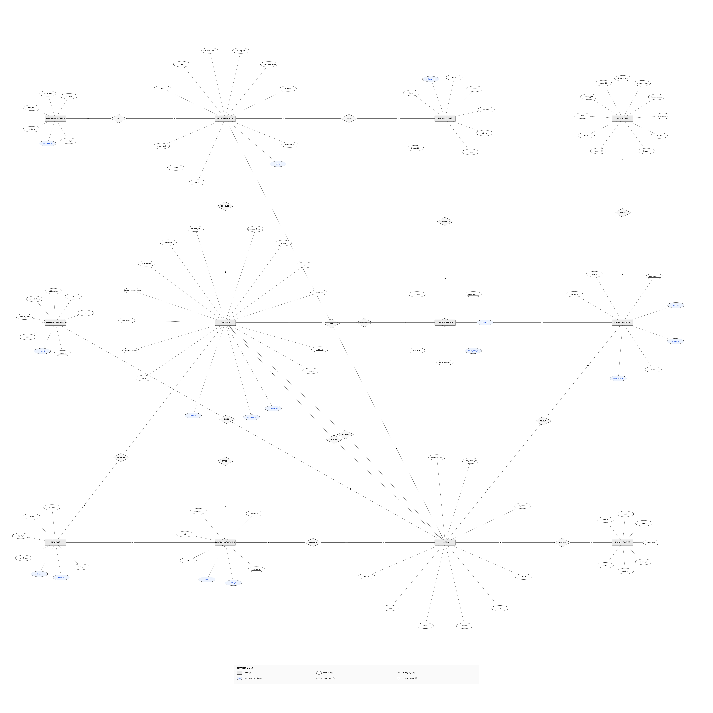

# Milestone 1 — Design Report

**COMP3019J Web Application Development 2026/27**
**Final Project · Milestone 1 (10%)**

| | |
|---|---|
| **Team name** | xLLM |
| **Team members** | Fu Rao (24107744), Liu Jing (24107741), Liu Zongrun (24107745), Zhou Jiaxu (24107758) |
| **Allocated topic** | Topic 7 — Food Delivery Website |
| **Repository** | *(to be created)* |

---

## 1. Project Overview

We are building a web application for a **local food delivery service** that connects three
distinct groups of participants: **customers**, **restaurants**, and **delivery riders**.

The application is not a simple ordering form. The topic describes an *application context*
rather than a fixed feature list, and the context is fundamentally about **coordination under
change**:

> *Each restaurant controls its own opening times, menu and preparation capacity, and this
> information may change during the day. Once an order is placed, the restaurant and a delivery
> member need to coordinate preparation and collection, while the customer expects useful
> information about progress. Delays, unavailable dishes, address problems or cancellations can
> interrupt the normal process. The service needs a website that keeps the different participants
> informed **without giving everyone access to the same information**.*
> — *Final Project Topics 2026/27, Topic 7*

Two sentences in that description define the whole project:

- **"coordinate preparation and collection"** — the order is a shared object whose *state* is
  advanced by different actors at different times. This is the backbone of the system.
- **"without giving everyone access to the same information"** — the central technical
  requirement is **role-based information isolation**, not the number of features.

We therefore treat this project as a **workflow-and-permissions problem**, and deliberately
scope the feature set around that core.

---

## 2. Users

We identified three primary user groups, derived directly from the topic statement. For each we
state who they are, what they need, and why the requirement follows from the topic.

### 2.1 Customer

| | |
|---|---|
| **Who** | An individual ordering food for delivery to an address |
| **Goal** | Order food from a nearby restaurant and know when it will arrive |
| **Context** | Uses a phone browser; short sessions; low tolerance for ambiguity |

**Justification.** The topic states *"the customer expects useful information about progress"*.
The customer never sees the kitchen or the rider, so **the website is their only source of
truth**. This makes *progress visibility* a first-class requirement rather than a nicety, and it
also means the customer must **not** see internal information (other customers' orders, kitchen
workload, rider personal data).

### 2.2 Restaurant staff

| | |
|---|---|
| **Who** | The owner or staff of one restaurant on the platform |
| **Goal** | Receive orders, prepare them, and hand them to a rider |
| **Context** | Busy, interrupt-driven environment; needs a fast, low-friction queue view |

**Justification.** The topic states *"Each restaurant controls its own opening times, menu and
preparation capacity, and this information may change during the day."* Three requirements
follow directly:

1. The restaurant — **not the platform** — owns its menu, opening hours, and availability.
2. Those values are **mutable within a day** (a dish sells out, the kitchen gets busy), so
   they cannot be static configuration.
3. A restaurant must only ever see **its own** orders and menu; the topic's final clause makes
   isolation between restaurants explicit.

### 2.3 Delivery rider

| | |
|---|---|
| **Who** | An independent courier who accepts delivery jobs |
| **Goal** | Find available jobs, collect the food, deliver it |
| **Context** | On a phone, moving, with intermittent attention |

**Justification.** The topic requires the restaurant and *"a delivery member"* to *"coordinate
preparation and collection"*. The rider therefore needs a **pool of orders that are ready to be
collected**, needs to **claim** one exclusively, and needs to signal collection and delivery.
A rider must not see orders that are not yet available, nor orders claimed by another rider.

### 2.4 Platform administrator — **excluded**

We considered a fourth "platform admin" role and **deliberately excluded it** from scope. The
topic describes a service connecting three parties and never mentions platform operations. Adding
an admin console would consume effort without addressing any stated requirement. We note it here
so the exclusion is a documented decision rather than an oversight.

---

## 3. Requirements

### 3.1 Functional requirements

Requirements are numbered `FR-n` and each is traced to its justification.

#### Authentication and access control

| ID | Requirement | Justification |
|---|---|---|
| FR-1 | A single registration/login entry point serving all three roles | One credential store; role determines the interface shown |
| FR-2 | The system must enforce that a user can only read or modify data they own or are party to | Topic: *"without giving everyone access to the same information"* |
| FR-3 | Every data-modifying action must be authorised on the **server**, not merely hidden in the UI | Client-side hiding is not access control: a user can modify requests |
| FR-4 | A restaurant must never see another restaurant's orders, menu, or revenue | Topic: *"several restaurants"* + isolation clause |

#### Restaurant management

| ID | Requirement | Justification |
|---|---|---|
| FR-5 | A restaurant can create, edit, and remove dishes, including price and availability | Topic: *"Each restaurant controls its own … menu"* |
| FR-6 | A restaurant can mark a dish as sold out, and set a remaining quantity | Topic: *"unavailable dishes"* is a named failure mode |
| FR-7 | A restaurant can configure opening hours per day of the week, and close for the day | Topic: *"controls its own opening times … may change during the day"* |
| FR-8 | A restaurant can set a preparation state on incoming orders | Topic: *"coordinate preparation"* |

#### Ordering

| ID | Requirement | Justification |
|---|---|---|
| FR-9 | A customer can browse restaurants and their menus | Baseline for any ordering flow |
| FR-10 | A customer can select a delivery address by pointing at a map | Topic: *"address problems"* — see §7.2 |
| FR-11 | The system must reject an order whose delivery address is outside the restaurant's delivery radius | Topic: *"address problems"* |
| FR-12 | A customer can place an order containing multiple dishes with quantities | An order is inherently one-to-many |
| FR-13 | An order records a **snapshot** of the delivery address and of each dish's name and price at the time of ordering | Orders are historical records; later edits must not rewrite history |
| FR-14 | A customer can view the progress of their own orders | Topic: *"the customer expects useful information about progress"* |

#### Order lifecycle and exceptions

| ID | Requirement | Justification |
|---|---|---|
| FR-15 | An order moves through an explicit, enforced state machine | Topic: *"coordinate preparation and collection"* |
| FR-16 | Only the role that owns a transition may perform it (e.g. only the restaurant may accept) | Topic: isolation clause; also prevents forged state changes |
| FR-17 | A customer may cancel free of charge before the restaurant accepts; afterwards cancellation requires the restaurant's agreement | Topic: *"cancellations … can interrupt the normal process"* |
| FR-18 | A restaurant may flag an order as delayed, and the customer sees this | Topic: *"Delays … can interrupt the normal process"* |
| FR-19 | A customer may change the delivery address before collection, and the assigned rider is notified | Topic: *"address problems"* |

#### Delivery

| ID | Requirement | Justification |
|---|---|---|
| FR-20 | A rider can view a pool of orders that are prepared and unclaimed | Topic: *"coordinate preparation and collection"* |
| FR-21 | Claiming an order must be atomic: two riders cannot claim the same order | Concurrency correctness |
| FR-22 | A rider can mark collection and delivery | Completes the workflow |
| FR-23 | A rider's position is reported to the server and shown to the customer of the active order | Topic: *"useful information about progress"* |

#### Feedback *(extension)*

| ID | Requirement | Justification |
|---|---|---|
| FR-24 | A customer can rate a completed order's restaurant and rider from 1–5 and leave a comment | Supports quality signals; also exercises the isolation rule |
| FR-25 | A review may only be written by the customer of that order, once per party | Prevents fabricated reviews |

#### Coupons *(extension — see §6.3)*

| ID | Requirement | Justification |
|---|---|---|
| FR-26 | The platform can issue coupons; a customer can claim and apply one at checkout | Differentiating feature; **not required by the topic** |

### 3.2 Non-functional requirements

| ID | Requirement | Justification |
|---|---|---|
| NFR-1 | All traffic served over HTTPS | Browser geolocation requires a secure context; also protects credentials |
| NFR-2 | Passwords stored only as salted hashes, never in plain text | Basic security; covered in Week 5 |
| NFR-3 | Access control enforced server-side on every endpoint | FR-3 |
| NFR-4 | The application must remain usable on a phone browser | Customers and riders are mobile-first |
| NFR-5 | Every attempt to access another party's data must be logged as a failed authorisation, not silently ignored | Auditability |
| NFR-6 | The system must degrade gracefully if the external map service is unavailable (text address still usable) | Availability |

---

## 4. Workflows

We define four workflows. The first three are the "happy paths" for each role; the fourth covers
the exception cases the topic explicitly names.

### 4.1 The order state machine (shared by all workflows)

The order is the shared object. Its state is the single source of truth for all three parties.

```
                    ┌──────────────────────────────────────────┐
                    │                                          │
   [customer]       ▼                                          │
   places      ┌─────────┐  [restaurant]  ┌──────────┐  ┌───────────┐
   order ─────▶│ pending │───accepts─────▶│ accepted │─▶│ preparing │
               └─────────┘                └──────────┘  └───────────┘
                    │                          │              │
                    │ customer cancels         │              │ restaurant
                    │ (free)                   │              │ marks ready
                    ▼                          ▼              ▼
               ┌───────────┐            ┌───────────┐   ┌─────────┐
               │ cancelled │◀───────────│ cancelled │   │  ready  │
               └───────────┘            └───────────┘   └─────────┘
                                                                │
                                              [rider] claims    │
                                                                ▼
                              ┌───────────┐  delivers   ┌────────────┐
                              │ delivered │◀────────────│ delivering │
                              └───────────┘             └────────────┘
                                    │
                                    ▼
                            [customer] reviews
```

| State | Meaning | Who may act next |
|---|---|---|
| `pending` | Placed, awaiting the restaurant | Restaurant accepts / Customer cancels free |
| `accepted` | Restaurant has taken the order | Restaurant starts preparing |
| `preparing` | Food is being made | Restaurant marks ready |
| `ready` | Prepared, awaiting collection | Any rider may claim |
| `delivering` | Rider has collected the food | Rider marks delivered |
| `delivered` | Complete | Customer may review |
| `cancelled` | Terminated | — |

**Design note.** `ready` is the *only* state in which an order enters the rider pool. This is the
precise mechanism that implements *"the restaurant and a delivery member need to coordinate
preparation and collection."*

### 4.2 WF-1: Customer orders food

```
1. Customer logs in
2. Browses restaurants (optionally filtered by distance)
3. Opens a restaurant → sees menu, opening hours, availability
       └─ if restaurant is closed or a dish is sold out, ordering is blocked for that item
4. Adds dishes to cart
5. Proceeds to checkout:
       a. selects a saved address, or picks a new point on the map
       b. system reverse-geocodes the point to a readable address
       c. system computes straight-line distance to the restaurant
       d. if distance > delivery radius → rejected with an explanation
       e. applies a coupon (optional)
6. Confirms → order created in state `pending`
7. Customer sees a progress view which updates as the order advances
```

### 4.3 WF-2: Restaurant fulfils an order

```
1. Restaurant logs in → sees an order queue for its own restaurant only
2. New order appears (state `pending`)
3. Accepts → `accepted`
4. Marks "preparing" → `preparing`
       └─ may flag a delay, which is surfaced to the customer
5. Marks "ready" → `ready`  → order enters the rider pool
6. If a dish runs out mid-service, marks it sold out; it disappears from the public menu
```

### 4.4 WF-3: Rider delivers an order

```
1. Rider logs in → sees the available pool (state `ready`, no rider assigned)
2. Claims an order
       └─ atomic claim: if another rider claimed it first, the claim fails cleanly
3. Sees pickup address, delivery address, and contents
4. Travels to the restaurant → confirms collection → `delivering`
5. Travels to the customer
       └─ reports position periodically; the customer sees it on a map
6. Confirms delivery → `delivered`
```

### 4.5 WF-4: Exception handling

The topic names four failure modes. Each is mapped to a concrete workflow.

| Exception | Handling |
|---|---|
| **Delay** | Restaurant or rider flags the order; the customer's progress view shows the delay and a revised estimate. Timestamps (`accepted_at`, `ready_at`, `picked_up_at`) record where time was actually spent. |
| **Unavailable dish** | Restaurant marks the dish sold out. It is hidden from the public menu and cannot be ordered. If it is already in a pending order, the restaurant contacts the customer via the order's contact details (the order retains the dish as a snapshot). |
| **Address problem** | Two cases: (a) the address is outside the delivery radius → rejected at checkout; (b) the customer changes the address before collection → the order's snapshot is updated and the assigned rider is notified. |
| **Cancellation** | Free while `pending`. After the restaurant accepts, cancellation requires the restaurant to agree, since preparation may have begun. The order records who cancelled and why. |

---

## 5. Functions

Summary of what the application does, by role.

### Customer
- Register / log in / log out
- Browse and search restaurants
- View a restaurant's menu, prices, calories, availability, opening hours
- Manage a list of delivery addresses (map-assisted)
- Shopping cart and checkout
- Apply a coupon
- Track order progress; view the rider's position on a map
- Cancel an order (within policy)
- Rate and comment on the restaurant and rider after delivery

### Restaurant
- Register / log in
- Configure shop profile, location (map), delivery radius, minimum order
- Configure opening hours per weekday
- Manage the menu: create / edit / delete dishes, set price, calories, stock, availability
- View and act on the incoming order queue
- Advance order states; flag delays
- View reviews and average rating

### Rider
- Register / log in
- Set availability
- View the claimable order pool
- Claim an order (atomic)
- View pickup and delivery details
- Confirm collection and delivery
- Report position during delivery
- View own delivery history and rating

### Platform *(minimal)*
- Issue coupons *(extension)*

---

## 6. Initial Design

### 6.1 System architecture

```
        ┌────────────────────┐   ┌────────────────────┐   ┌────────────────────┐
        │  Customer (phone)  │   │ Restaurant (desk)  │   │   Rider (phone)    │
        └─────────┬──────────┘   └─────────┬──────────┘   └─────────┬──────────┘
                  │                        │                        │
                  └────────────────────────┼────────────────────────┘
                                           │  HTTPS
                                           ▼
                              ┌─────────────────────────┐
                              │          nginx          │
                              │  TLS termination        │
                              │  static files           │
                              │  /api/ → reverse proxy  │
                              └────────────┬────────────┘
                                           │  http (loopback only)
                                           ▼
                              ┌─────────────────────────┐
                              │   gunicorn (WSGI)       │
                              │   127.0.0.1:8080        │
                              └────────────┬────────────┘
                                           │
                              ┌────────────▼────────────┐
                              │   Flask application     │
                              │  ┌───────────────────┐  │
                              │  │ customer/         │  │
                              │  │ merchant/         │  │
                              │  │ rider/            │  │
                              │  │ shared/           │  │
                              │  └───────────────────┘  │
                              │  ┌───────────────────┐  │
                              │  │ SQLAlchemy models │  │
                              │  └───────────────────┘  │
                              └───────┬─────────┬───────┘
                                      │         │
                          ┌───────────▼──┐  ┌───▼──────────────┐
                          │   MySQL 8    │  │  Amap Web API    │
                          │  (13 tables) │  │  (geocoding /    │
                          └──────────────┘  │   distance)      │
                                            └──────────────────┘
```

The backend is the only component with database credentials and the only holder of the map
service's server-side key. The browser never contacts the database.

### 6.2 Database design

The full schema comprises **13 tables**. The entity-relationship diagram below uses Chen
notation (as taught in the database module): rectangles for entities, ellipses for attributes,
diamonds for relationships, and cardinality labels on the connecting lines. Primary keys are
underlined. Foreign-key attributes are additionally tinted for cross-reference with the physical
schema; standard notation reserves the dashed underline for the partial key of a weak entity,
so it is not used here.



The diagram is a **conceptual** model and shows the business-relevant attributes only; the
physical definition, including audit columns and snapshot fields, is given in
`database/schema.sql`.

> **Implementation note (M2).** One table was added after this report was written:
> `rider_profiles` (1:1 with a rider user) holds `is_online`, `vehicle_type` and
> `service_radius_km`. The alternative — putting those columns on `users` — would leave two
> thirds of every customer and restaurant row permanently `NULL`, and the online flag is what
> gates the claimable-order pool. Three columns were also added to existing tables:
> `restaurants.cuisine`, `restaurants.max_concurrent_orders`, `restaurants.avg_prep_minutes`
> (the topic's *preparation capacity* has to live somewhere), `orders.preparing_at`, and
> `orders.delay_flagged_at` / `delay_reason` (the topic's *delays*). Rationale:
> [`docs/数据库设计.md`](数据库设计.md).

**Tables**

| Table | Purpose |
|---|---|
| `users` | All three roles in one table, discriminated by `role` |
| `restaurants` | Shop profile owned by a `restaurant` user |
| `opening_hours` | Per-weekday opening times |
| `menu_items` | Dishes, prices, calories, stock, availability |
| `customer_addresses` | A customer's saved delivery addresses |
| `orders` | **Core table** — state machine, address snapshot, amount snapshot, timestamps |
| `order_items` | Line items of an order, with name and price snapshots |
| `reviews` | Restaurant and rider reviews, discriminated by `target_type` |
| `rider_locations` | Position reports from riders |
| `email_codes` | Short-lived e-mail verification codes (password reset / code login) |
| `coupons`, `user_coupons` | Coupon definitions and claims *(extension)* |

**Key design decisions**

1. **One `users` table with a `role` column.** Relational databases have no inheritance, and
   duplicating name/phone/password across three tables would triple the authentication logic.
   A single table gives one login path, one password check, and a uniform `role` check for
   authorisation.

2. **Orders store snapshots, not references.** An order records the delivery address *text and
   coordinates* and each line item's *name and unit price* at the moment of ordering. If orders
   referenced the live address or menu rows instead, a customer editing their address or a
   restaurant raising a price would silently rewrite the history of past orders. This is stated
   as FR-13.

3. **Explicit state column with enforced transitions.** `orders.status` is an `ENUM` covering the
   seven states in §4.1. Transitions are validated in the backend against the acting user's role.

4. **Multiple timestamps rather than one.** `created_at`, `accepted_at`, `ready_at`,
   `picked_up_at`, `delivered_at`, `cancelled_at`. These are not decoration — they are the data
   behind "progress", and they allow the delay analysis required by FR-18
   (e.g. `ready_at − accepted_at` is the kitchen's actual preparation time).

5. **One `reviews` table with `target_type`.** Restaurant and rider reviews have identical shape;
   two tables would duplicate every query. A `UNIQUE (order_id, target_type)` constraint enforces
   one review per party per order, and the `order_id` foreign key guarantees that only the
   customer of that order can review it.

### 6.3 Scope note on coupons

Coupons (FR-26) are **not mentioned anywhere in the topic description**. We include them as an
explicitly-labelled extension because they exercise the ordering and pricing model more
thoroughly. They are scheduled **after** the core workflow is complete (§9), so that they cannot
delay the required functionality.

### 6.4 Interface design

Each role receives a separate interface. The pages are:

**Customer** — Login/Register · Restaurant list · Restaurant detail & menu · Cart & checkout
(address picker, map, coupon) · Order progress (status timeline, map) · Order history ·
Address book · Review form

**Restaurant** — Login/Register · Order queue (live) · Order detail · Menu management
(list, add/edit dish) · Opening hours · Shop profile (map location picker) · Reviews

**Rider** — Login/Register · Available order pool · Active delivery (pickup/delivery addresses,
map, status buttons) · Delivery history

**The three interfaces are designed independently, not as three skins over one layout.** The three
parties use the application in genuinely different circumstances: a customer browses on a phone and
makes one decision per screen; a restaurant works through a dense order queue on a desktop; a rider
operates one-handed, outdoors, while moving. Commercial platforms separate their customer app,
merchant portal and courier app for exactly this reason — they are different products serving
different contexts, and no single user ever holds two of these roles at the same time. We follow
that practice: each role gets its own colour system, typographic scale and component geometry, so
that each interface is optimised for its own context instead of being compromised to match the
other two. In concrete terms the customer interface uses 48px pill-shaped buttons over a shadowed
card layer; the restaurant interface uses 32px squared controls inside a dense 56px-row table; the
rider interface uses 56px touch targets with a raised type scale for outdoor legibility.

What the three interfaces *do* share is deliberately **not visual**: they share one terminology (the
same seven order-state names across all three), one product name, one date/amount formatting
convention, and one API contract. Our consistency is consistency of language and data, not of
pixels — the data model and the order state machine are what make this one service rather than
three unrelated applications. All interface copy is in English, matching the language of this
report and of the module, so that the three interfaces remain directly comparable during the
demonstration without needing translation.

Wireframes will be produced in Milestone 1 follow-up and included in the repository.

---

## 7. Proposed Technologies

### 7.1 Core stack — all covered in lectures

| Layer | Technology | Covered in |
|---|---|---|
| Page structure | HTML5 | Week 1–2 |
| Styling | CSS3 | Week 2 |
| Client-side logic | JavaScript (ES6) | Week 6 |
| Asynchronous requests | jQuery / AJAX | Week 7 |
| Templating | Jinja2 | Week 3 |
| Backend | **Python 3.10 + Flask 3.1** | Week 3–4 |
| ORM | SQLAlchemy 2.0 | Week 4 |
| Database | **MySQL 8** | Week 3–4 |
| Sessions / authentication | Flask session | Week 5 |

We chose this stack because it is the stack taught on the module, which means (a) no additional
technology approval is required under §4 of the brief, and (b) the project directly reinforces
the assessed material.

### 7.2 ⚠️ Technology not covered in class — declaration under brief §4

We propose **one** technology that has not been covered in lectures.

#### Amap (Gaode) Maps API — *Web端 JS API* and *Web服务 API*

**What it will be used for**

1. Letting a restaurant mark its location on a map when registering, producing coordinates.
2. Letting a customer select a delivery address by pointing at a map, then converting that point
   into a readable address (reverse geocoding).
3. Displaying restaurant and delivery locations.
4. Server-side geocoding and distance calculation where needed.

**Why it is appropriate for this application**

This is justified by a requirement the topic states explicitly, not by preference:

> *Delays, unavailable dishes, **address problems** or cancellations can interrupt the normal
> process.*

Hand-typed addresses are the primary source of "address problems": the same street name may exist
in several districts, house numbers may be missing, and free-text descriptions are ambiguous. By
letting the user **point at a map**, the delivery address is captured as a pair of coordinates,
which removes that ambiguity at the source.

Coordinates are also a precondition for two further requirements. The topic requires restaurants
to control their **preparation capacity** and customers to be shown **useful information about
progress**; in a delivery context both depend on knowing *where* things are — a restaurant cannot
define a serviceable area without spatial data, and progress cannot be shown on a map without
coordinates.

Finally, we note a deliberate limitation: **we use only straight-line (Haversine) distance for
the delivery-radius check**, computed locally, rather than the routing API. This keeps external
API consumption low and means the core ordering flow continues to work even if the map service is
unavailable (NFR-6).

**Current status.** We have already implemented and verified the integration: JavaScript API
loading, map rendering, reverse geocoding, browser geolocation, and the server-side geocoding /
distance / routing endpoints all function correctly against our deployment.

**Fallback if not approved.** The address field reverts to plain text and the delivery radius is
checked by administrative district. No other part of the design depends on the map service.

#### SMTP e-mail — password recovery and code login

**What it will be used for.** Sending a short-lived one-time code to a registered e-mail address
for (a) resetting a forgotten password, and (b) an optional alternative login in which the user
enters a code instead of a password.

**Why it is appropriate — and why it is safe.**

Password recovery has an unavoidable requirement: it must let a user who is **not logged in**
prove that they control the account they registered. This needs an out-of-band channel already
verified to belong to that account.

SMS would be the conventional commercial choice but is not available to us: in mainland China,
programmatic SMS requires a registered sender signature and pre-approval of every message
template, both costing money and taking several working days. SMTP e-mail is the only channel
that is free, immediate and available in a course environment.

Crucially, **e-mail is not on the critical path of the application**:

- Primary login is **username/email + password**, involving no external service at all.
- E-mail is used only for *password recovery* and the *optional* code-login path.
- Sending is failure-isolated: the mailer catches every exception and the request still
  succeeds. A user can always log in even if the mail service is unavailable.
- Expiry, single use, attempt limiting and rate limiting are enforced on the code record in our
  own database, so the security properties do not depend on the mail server.

The requirement for password recovery justifies the technology, and the design ensures that a
failure of that technology cannot prevent anyone from using the application.

**Fallback if not approved.** Password recovery reverts to an administrator-assisted reset.
Username + password login — what the demonstration relies on — is unaffected.

---

## 8. Division of Work

Work is divided by **end-user role**, plus a dedicated backend owner. Each front-end owner also
implements the server-side endpoints for their own role, so that every member owns one complete
vertical slice (interface → API → database) and can explain it end to end — as required by §7 of
the brief.

| Member | Front-end | Back-end |
|---|---|---|
| Fu Rao | Customer interface | Customer-facing endpoints; reviews |
| Liu Jing | Restaurant interface | Restaurant, menu and opening-hours endpoints |
| Zhou Jiaxu | Rider interface | Rider pool, claim, location reporting |
| **Liu Zongrun** | — | Shared data models, authentication and authorisation, **order state machine**, API contract, code review, deployment |

**Shared responsibilities**

- All members contribute to the Milestone 1 report and interface design.
- Liu Zongrun freezes the API contract and the database schema **before** parallel development
  begins, so that the three interface owners are not blocked.
- Every member must be able to explain the shared application, not only their own part (§7).

**Risk.** A single backend owner is a potential bottleneck. We mitigate this by (a) freezing the
API contract first, (b) giving each front-end owner their own backend endpoints, and (c) keeping
only the truly shared logic (state machine, authorisation) centralised.

---

## 9. Development Plan

| Phase | Content | Deliverable |
|---|---|---|
| **0. Foundation** ✅ done | Stack decision; server, HTTPS, WSGI deployment; map API keys and verification; database schema designed and created | Working deployment; 11-table schema |
| **1. Design (M1)** | **API contract frozen**; SQLAlchemy models; interface wireframes | **M1 report** |
| **2. Skeleton + auth** | Registration, login, sessions, role-based authorisation decorator; three interface shells; one working read endpoint per role | End-to-end path proven |
| **3. Core workflow (M2)** | Restaurant menu and hours management; customer browse → cart → checkout; **order state machine**; rider pool → claim → collect → deliver | **M2 Beta** |
| **4. Extensions** | Map display; rider position reporting; reviews; coupons; exception flows (cancel, sold out, delay) | Feature-complete |
| **5. Finalisation (M3)** | Report; contribution statement; demonstration rehearsal; documentation | **M3 submission** |

**Scope discipline.** Phases 0–3 constitute the required functionality. Phase 4 is additive. If
time is short, Phase 4 is reduced before Phase 3 is compromised.

---

## 10. Summary of Design Decisions

| Decision | Rationale |
|---|---|
| Scope built around workflow and permissions, not feature count | The topic's own emphasis |
| No platform-admin role | Not described in the topic |
| Simulated payment, no payment gateway | The topic never mentions payment; a gateway adds risk without addressing a requirement |
| Straight-line distance rather than routing | Lower API dependency; sufficient for a radius check |
| Coupons treated as a labelled extension and scheduled last | Not required by the topic |
| Orders store snapshots of address and price | History must not be rewritten by later edits |
| One `users` table with `role` | Relational databases have no inheritance; one login path |

---

## Appendix A — Requirement traceability

| Topic phrase | Requirements |
|---|---|
| connects customers, several restaurants and delivery staff | FR-1, FR-4 |
| Each restaurant controls its own opening times | FR-7 |
| …menu | FR-5 |
| …and preparation capacity | FR-6, FR-8 |
| …may change during the day | FR-6, FR-7 |
| coordinate preparation and collection | FR-15, FR-20, FR-21, FR-22 |
| customer expects useful information about progress | FR-14, FR-23 |
| Delays | FR-18 |
| unavailable dishes | FR-6 |
| address problems | FR-10, FR-11, FR-19 |
| cancellations | FR-17 |
| without giving everyone access to the same information | FR-2, FR-3, FR-4, FR-16, FR-25 |

## Appendix B — Project artefacts

| Artefact | Location |
|---|---|
| Database schema (DDL) | `database/schema.sql` |
| ER diagram (conceptual, Chen notation) | `database/ER图.png`, `database/ER图.svg` |
| ER diagram generator | `database/生成ER图.py` |
| Physical schema diagram (crow's foot) | `database/物理模型图.png` |
| Database design rationale | `docs/数据库设计.md` |
| Project plan | `docs/项目规划.md` |
| Deployment guide | `docs/部署说明.md` |
| Design language — three independent role systems | `docs/设计语言.md`, `server/{customer,merchant,rider}/static/css/{role}.css` |
| Component reference sheets (one per role) | `/customer/design-system`, `/merchant/design-system`, `/rider/design-system` |
| Code layout (per-role isolation, defence guide) | `docs/代码结构.md`, `server/customer/`, `server/merchant/`, `server/rider/`, `server/shared/` |
| Interface reference screenshots (66, three products) | `docs/reference/ui/` |
| API contract | `docs/API契约.md` *(phase 1)* |
